# 🤖 Awesome Embodied AI & Robotics Benchmarks

<p align="center">
  
</p>

<p align="center">
  <a href="https://github.com/ishandutta2007/Awesome-Embodied-AI-Robotics-Benchmarks"></a>
  <a href="https://github.com/ishandutta2007/Awesome-Embodied-AI-Robotics-Benchmarks/stargazers"></a>
  <a href="https://github.com/ishandutta2007/Awesome-Embodied-AI-Robotics-Benchmarks/network/members"></a>
  <a href="https://github.com/ishandutta2007/Awesome-Embodied-AI-Robotics-Benchmarks/blob/main/LICENSE"></a>
  <a href="https://github.com/ishandutta2007/Awesome-Embodied-AI-Robotics-Benchmarks/pulls"></a>
</p>

---

## 📌 Executive Summary & Introduction

Welcome to **Awesome Embodied AI & Robotics Benchmarks** — a curated, production-grade index of commercial simulation clouds, high-performance GPU physics engines, Vision-Language-Action (VLA) evaluation suites, dexterous manipulation testbeds, and photorealistic 3D indoor arenas.

Whether you are evaluating humanoid locomotion policies, training multi-task foundation models on manipulation datasets (e.g., Open X-Embodiment, Bridge), conducting sim-to-real domain randomization, or running regression tests across simulated robot fleets, this guide outlines the key tools, transparent pricing structures, and community-standard open-source repositories.

---

## 📑 Table of Contents

- [📊 Sector Overview & Market Dynamics](#-sector-overview--market-dynamics)
- [☁️ SaaS & Commercial Simulation Platforms](#️-saas--commercial-simulation-platforms)
- [💻 Open-Source Benchmark Suites & Physics Simulators](#-open-source-benchmark-suites--physics-simulators)
- [🎯 Benchmark Taxonomy & Evaluation Dimensions](#-benchmark-taxonomy--evaluation-dimensions)
- [🛠️ How to Contribute](#️-how-to-contribute)
- [📄 License & Disclaimers](#-license--disclaimers)

---

## 📊 Sector Overview & Market Dynamics

The global **Robotics Simulation, Embodied AI, and Physical Intelligence Software market is estimated at approximately $2.6B–$3.4B in 2026** (scaling within the broader **$48B+ physical AI, industrial automation, and autonomous systems ecosystem**), expanding at an annualized compound rate of **~18%–24% CAGR**. Market acceleration is catalyzed by massive venture and corporate capital deployments into humanoid robotics, generative world models, and multi-modal Vision-Language-Action (VLA) foundation architectures.

In terms of market structure, the sector exhibits **bimodal fragmentation**:
- **Cloud Infrastructure & Acceleration (High Concentration / Winner-Take-Most):** The underlying GPU acceleration and photorealistic rendering layer is highly concentrated among mega-cap technology leaders—predominantly **NVIDIA (Omniverse / Isaac)** alongside cloud hyperscalers (**AWS RoboMaker**, **Google Cloud Vertex AI**). Their proprietary ray-tracing hardware, USD ecosystem pipelines, and compute moats make displacement difficult for independent entrants.
- **Physics Simulation & Benchmark Suites (Moderately to Highly Fragmented):** Conversely, the policy evaluation, dexterous task benchmarking, and specialized physics layer remains fragmented across academic consortia and research institutions (e.g., Google DeepMind's MuJoCo/MJX, Stanford ILIAD, UC San Diego's ManiSkill, Meta AI's Habitat, and the Genesis Consortium). No single suite possesses a universal monopoly because different mechanical domains (e.g., rigid multi-contact, soft deformable tissue, granular terrain, high-fidelity tactile feedback, photorealistic navigation) demand differentiated physics solvers and sensor representations.

---

## ☁️ SaaS & Commercial Simulation Platforms

The following commercial simulation clouds, hosted environments, and proprietary robotics suites are **sorted in descending order by company scale (market valuation / annual revenue)**. All pricing figures represent exact starting tiers and verified free tier / trial limits.

| 🏢 Platform / Service | 📖 Core Capabilities & Focus | 📈 Company Scale (Valuation / Revenue) | 🏷️ Starting Paid Tier | 🎁 Free Tier / Free Trial Limits |
| :--- | :--- | :--- | :--- | :--- |
| **[Google DeepMind Simulation (MuJoCo Cloud / GCP Vertex AI)](https://deepmind.google/technologies/mujoco/)** | Cloud-native multi-joint contact physics with GPU/TPU MJX scaling for massively parallel RL locomotion and manipulation policies. | **Part of Alphabet / Google** (~$350B+ annual revenue; ~$2.1T+ market capitalization) | **$9.99/mo** (Google Colab Pro tier with high-RAM A100 GPU compute instances) | **100% Free Forever** (Engine is fully free Apache-2.0; Google Colab free tier includes 12-hour session limits with free T4 GPU access) |
| **[NVIDIA Isaac Sim & Omniverse Cloud](https://developer.nvidia.com/isaac/sim)** | Photorealistic, physics-accurate GPU simulation environment built on OpenUSD and PhysX 5 with Isaac Lab reinforcement learning frameworks. | **Part of NVIDIA Corp.** (~$130B+ annual revenue; ~$3.5T+ market capitalization) | **~$4.50 / GPU-hour** (Omniverse Cloud streaming via Microsoft Azure / AWS partner marketplaces) | **100% Free Local Workstation License** (Full unthrottled personal license for local RTX GPUs; 30-day trial with 50 compute credits via NVIDIA LaunchPad) |
| **[AWS RoboMaker](https://aws.amazon.com/robomaker/)** | Fully managed cloud robotics simulation service running automated parallel Gazebo/ROS 2 batch suites for regression and CI/CD validation. | **Part of Amazon Web Services** (~$115B+ AWS annual revenue; ~$2.2T+ parent market capitalization) | **$0.40 per Simulation Unit (SU) / hour** (1 SU = 1 vCPU + 2 GB RAM, billed per-second with 1-minute minimum) | **12-Month AWS Free Tier** (25 Simulation Unit hours free per month for the first 12 months on newly registered AWS accounts) |
| **[Meta AI Habitat Ecosystem](https://aihabitat.org/)** | Photorealistic 3D indoor simulation engine optimized for indoor navigation, object manipulation, and social embodied agents in Matterport3D/HM3D spaces. | **Backed by Meta Platforms** (~$160B+ annual revenue; ~$1.6T+ market capitalization) | **$0 / Open Research Infrastructure** (Cloud execution billed on user compute clusters, e.g., AWS EC2 P4d starting at **$32.77/hr**) | **100% Free Forever** (Full Habitat-Sim, Habitat-Lab, and Matterport3D/HM3D academic research access at $0 license fee) |
| **[Gazebo Cloud (OSRF / Intrinsic)](https://gazebosim.org/)** | Cloud-ready open-standard robotic simulation suite with ROS 2 native transport, modular physics backends, and cloud Fuel asset management. | **Part of Intrinsic (Alphabet Company) & Open Source Robotics Foundation** | **$0 / Core Open Platform** (Enterprise hosting & custom simulation integrations via Intrinsic Flow / cloud partners) | **100% Free Forever** (Unlimited local simulation worlds, open-source physics engines, and free public Gazebo Fuel asset registry access) |
| **[CoppeliaSim Pro (Coppelia Robotics)](https://www.coppeliarobotics.com/)** | Commercial multi-physics simulator (integrating MuJoCo, Bullet, ODE, and Newton) with kinematic forward/inverse solvers and Python/C++ interfaces. | **~$5M–$15M Est. Company Valuation** (Independent Swiss robotics simulation vendor) | **$1,990 one-time fee** (CoppeliaSim Pro perpetual commercial standalone license with 1 year of updates) | **100% Free Forever Educational Tier** (CoppeliaSim Edu is completely free forever for non-commercial education and academic lab research with full feature parity) |
| **[Webots Cloud (Cyberbotics)](https://webots.cloud/)** | Hosted cloud simulation infrastructure allowing web browser execution and automated continuous benchmarking of Webots robot models and competitions. | **~$3M–$10M Est. Company Valuation** (Specialist robotics simulation pioneer founded in Switzerland) | **€1,500 / year** (Webots Premier commercial enterprise support and dedicated benchmark hosting SLA) | **100% Free Forever** (Webots desktop is 100% free Apache-2.0; Webots.cloud hosted simulation portal is free for public robotics benchmarks) |
| **[Genesis Embodied AI Cloud](https://genesis-embodied-ai.github.io/)** | Ultra-high-speed generative physics engine simulating rigid bodies, articulated robots, fluids, and soft deformable objects at up to 430,000 FPS. | **Academic & Open-Source Venture Consortium** (Multi-university embodied AI consortium) | **$0 / Engine Platform** (Deployable across commercial cloud providers; GPU instance compute starting at **~$0.75/hr** via Lambda Cloud) | **100% Free Forever** (Open Apache-2.0 core, complete cross-physics capabilities, and unlimited local simulation instances) |
| **[Project Chrono (Delta-R & University Consortium)](https://projectchrono.org/)** | Industrial-grade multi-physics simulation engine specializing in tracked/wheeled vehicles, granular soil mechanics, flexible bodies, and fluid-solid interaction. | **Academic & Engineering Consortium** (Backed by NSF, DoD, and Delta-R engineering spin-off) | **$0 / Open Engine** (Commercial engineering consulting, specialized validation, and solver contracts starting at **~$5,000/engagement**) | **100% Free Forever** (Full BSD-3 open source multi-physics library with unlimited local cores and cluster execution) |

---

## 💻 Open-Source Benchmark Suites & Physics Simulators

The following open-source benchmark repositories, environments, and physics simulators are **sorted in descending order by GitHub Stargazer Count**. Each entry includes an official stargazers link badge (`style=social`, `color=white`).

| 📦 Repository & Benchmark Suite | ⭐ Stargazers | 📜 License | 🎯 Target Domain & Key Capabilities |
| :--- | :--- | :--- | :--- |
| **[Genesis](https://github.com/Genesis-Embodied-AI/Genesis)** | [](https://github.com/Genesis-Embodied-AI/Genesis/stargazers) | Apache-2.0 | Next-generation generative physics simulation platform combining rigid bodies, liquid fluids, MPM deformable materials, and ray-traced rendering at extreme speeds (>400,000 FPS). |
| **[MuJoCo](https://github.com/google-deepmind/mujoco)** | [](https://github.com/google-deepmind/mujoco/stargazers) | Apache-2.0 | Multi-Joint dynamics with Contact physics engine by Google DeepMind. The worldwide gold standard for continuous control, humanoid locomotion, and contact-rich manipulation. |
| **[Bullet Physics & PyBullet](https://github.com/bulletphysics/bullet3)** | [](https://github.com/bulletphysics/bullet3/stargazers) | zlib | Real-time multi-physics simulation suite including PyBullet Python bindings for collision detection, inverse kinematics, and reinforcement learning robot gym environments. |
| **[Isaac Lab](https://github.com/isaac-sim/IsaacLab)** | [](https://github.com/isaac-sim/IsaacLab/stargazers) | BSD-3-Clause | Unified modular framework built on NVIDIA Isaac Sim for robot learning, humanoid locomotion policies, dexterous hand manipulation, and zero-shot sim-to-real workflows. |
| **[Webots](https://github.com/cyberbotics/webots)** | [](https://github.com/cyberbotics/webots/stargazers) | Apache-2.0 | Open-source cross-platform 3D robot simulator offering rapid modeling, extensive sensor libraries (LiDAR, RGB-D, IMU), ROS/ROS 2 integration, and automated cloud benchmarks. |
| **[Habitat-Sim](https://github.com/facebookresearch/habitat-sim)** | [](https://github.com/facebookresearch/habitat-sim/stargazers) | MIT | High-performance 3D simulator rendering thousands of frames per second on Matterport3D, Gibson, and HM3D datasets for point-goal navigation and embodied household rearrangement. |
| **[ManiSkill](https://github.com/haosulab/ManiSkill)** | [](https://github.com/haosulab/ManiSkill/stargazers) | Apache-2.0 | GPU-parallelized robotics manipulation benchmark and simulator powered by SAPIEN, offering thousands of simulated rigid/soft object manipulation environments at over 30,000 FPS. |
| **[Brax](https://github.com/google/brax)** | [](https://github.com/google/brax/stargazers) | Apache-2.0 | Differentiable physics engine written in JAX by Google Research, supporting hardware-accelerated parallel simulation of rigid body mechanics directly on GPUs and TPUs. |
| **[Robosuite](https://github.com/ARISE-Initiative/robosuite)** | [](https://github.com/ARISE-Initiative/robosuite/stargazers) | Apache-2.0 | Standardized modular simulation framework powered by MuJoCo for robot manipulation benchmarking, teleoperation interfaces, and imitation learning dataset generation. |
| **[LIBERO](https://github.com/Lifelong-Robot-Learning/LIBERO)** | [](https://github.com/Lifelong-Robot-Learning/LIBERO/stargazers) | MIT | Standardized benchmark suite for lifelong robot learning and knowledge transfer, evaluating foundation VLA policies across sequential manipulation challenges and procedural scenes. |
| **[Gymnasium-Robotics](https://github.com/Farama-Foundation/Gymnasium-Robotics)** | [](https://github.com/Farama-Foundation/Gymnasium-Robotics/stargazers) | MIT | Farama Foundation's official collection of robotic simulation environments (Fetch arm, Shadow Dexterous Hand, Franka Emika Panda) maintained for RL benchmarking. |
| **[RLBench](https://github.com/stepjam/RLBench)** | [](https://github.com/stepjam/RLBench/stargazers) | Custom Academic | Large-scale robot learning benchmark and environment suite built on PyRep and CoppeliaSim with over 100 diverse vision-guided manipulation tasks. |
| **[AI2-THOR](https://github.com/allenai/ai2thor)** | [](https://github.com/allenai/ai2thor/stargazers) | Apache-2.0 | Photorealistic interactive simulation platform by Allen Institute for AI (AI2) featuring near-photorealistic indoor rooms, physical object interactions, and task-planning agents. |
| **[SimplerEnv](https://github.com/simpler-env/SimplerEnv)** | [](https://github.com/simpler-env/SimplerEnv/stargazers) | MIT | Real-to-sim evaluation framework evaluating and validating real-world robot manipulation policies (such as RT-1, RT-1-X, and Octo) under matched simulation environments. |
| **[CALVIN](https://github.com/mees/calvin)** | [](https://github.com/mees/calvin/stargazers) | MIT | Open-source benchmark for learning long-horizon language-conditioned robot manipulation tasks across multiple distinct tabletop scenes and camera viewpoints. |
| **[SAPIEN](https://github.com/haosulab/SAPIEN)** | [](https://github.com/haosulab/SAPIEN/stargazers) | Apache-2.0 | Realistic and physics-rich simulation engine developed at UC San Diego with ray-tracing support and PartNet-Mobility integration for articulated object manipulation. |
| **[Embodied First Exam](https://github.com/mll-lab-nu/embodied-first-exam)** | [](https://github.com/mll-lab-nu/embodied-first-exam/stargazers) | Apache-2.0 | Foundational evaluation suite measuring spatial cognition, affordance prediction, physical reasoning, and multi-step tool use in embodied foundation AI agents. |

---

## 🎯 Benchmark Taxonomy & Evaluation Dimensions

Modern embodied AI evaluation protocols assess agent policies along five core axes:

```
               ┌────────────────────────────────────────────────────────┐
               │    Embodied AI & Robotics Benchmark Spectrum           │
               └────────────────────────────────────────────────────────┘
                                           │
         ┌───────────────────┬─────────────┴─────────────┬───────────────────┐
         ▼                   ▼                           ▼                   ▼
┌──────────────────┐┌──────────────────┐   ┌──────────────────┐┌──────────────────┐
│  Physics & Speed ││   VLA & Language │   │  Locomotion &    ││  Photorealistic  │
│  (FPS Scaling)   ││   Manipulation   │   │  Dexterity       ││  Indoor 3D       │
├──────────────────┤├──────────────────┤   ├──────────────────┤├──────────────────┤
│• Genesis         ││• LIBERO          │   │• MuJoCo / MJX    ││• Habitat-Sim     │
│• Isaac Lab       ││• SimplerEnv      │   │• Isaac Lab       ││• AI2-THOR        │
│• Brax            ││• ManiSkill       │   │• Gymnasium-Rob   ││• SAPIEN          │
│• Bullet / PyBul  ││• CALVIN          │   │• Robosuite       ││• Webots          │
└──────────────────┘└──────────────────┘   └──────────────────┘└──────────────────┘
```

1. **⚡ Physics Simulation Throughput:** Rate of parallel step simulation (measured in steps per second / FPS). GPU engines (Genesis, Isaac Lab, MJX) achieve 10,000–400,000+ FPS, enabling millions of training steps within minutes.
2. **🦾 Dexterous Manipulation:** Contact stability, multi-fingered grasp verification, deformable/granular object interaction, and articulation tracking (e.g., ManiSkill, Robosuite, RLBench).
3. **🧠 Vision-Language-Action (VLA) Reasoning:** Testing whether multi-modal foundation models understand natural language instructions, visual scene context, and spatial affordances (e.g., LIBERO, SimplerEnv, CALVIN, Embodied First Exam).
4. **🚶 Humanoid & Quadruped Locomotion:** Complex foot-terrain contact, zero-shot balance recovery, and dynamic terrain traversal (e.g., MuJoCo, Isaac Lab, Brax).
5. **🏠 Embodied Navigation & Rearrangement:** Long-horizon indoor exploration, photorealistic RGB-D sensor simulation, semantic goal navigation, and room rearrangement (e.g., Habitat-Sim, AI2-THOR).

---

## 🛠️ How to Contribute

We encourage researchers, engineers, and simulator maintainers to submit updates:

1. **Fork** this repository.
2. **Add or update** your platform or open-source suite following the existing table schema.
3. Ensure that SaaS entries list **precise starting price points** and **explicit free tier/trial limits**.
4. Ensure open-source entries include the proper stargazer badge format: `[](https://github.com/<owner>/<repo>/stargazers)`.
5. Submit a **Pull Request** with a concise summary of the changes.

---

## 📄 License & Disclaimers

- Distributed under the **MIT License**. See [LICENSE](file:///C:/Users/ishan/Documents/Projects/Awesome-Embodied-AI-Robotics-Benchmarks/LICENSE) for more information.
- Product names, logos, and brands mentioned herein are properties of their respective owners. Mention does not imply endorsement.
- Stargazer metrics and pricing structures are refreshed periodically to reflect active market pricing as of 2026.

<p align="center">
  <i>Maintained with ❤️ by the open robotics and embodied AI research community.</i>
</p>
